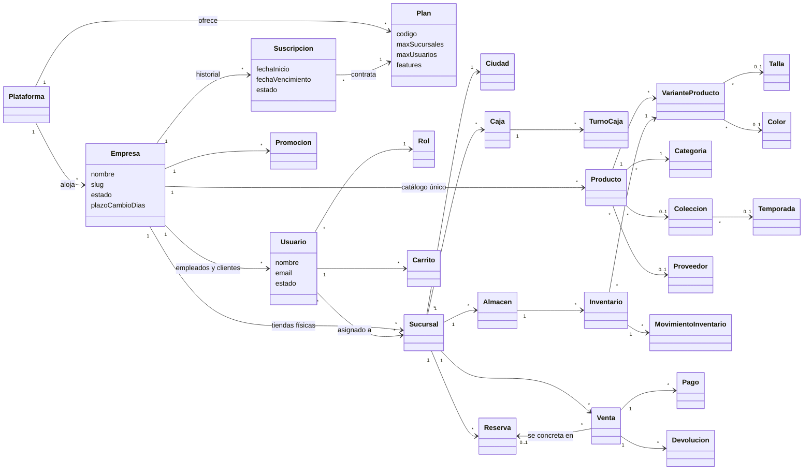

# ICONIX — 01. Modelo de dominio (FashionStore SaaS)

> Versión 1 · 2026-10-25 · Rama `feat/saas`
> Refleja lo implementado en la migración `1780000000000-AddMultitenancy` (RNF12: coherencia documental).

## ¿Qué es el modelo de dominio en ICONIX?

En ICONIX, el **modelo de dominio** es el primer artefacto: un diagrama de clases *conceptual* con los objetos del negocio y sus relaciones, sin métodos ni detalles técnicos. Sirve de vocabulario común; los casos de uso, los diagramas de robustez y de secuencia usan exactamente estos nombres. Se refina en cada iteración hasta convertirse en el diagrama de clases de diseño.

## Conceptos nuevos del SaaS

| Concepto | Significado |
|---|---|
| **Plataforma** | FashionStore como servicio. La administra el `SUPER_ADMIN` |
| **Plan** | Básico, Profesional o Empresarial. Define límites (sucursales, empleados) y funcionalidades (IA, ML) |
| **Empresa** (tenant) | Negocio de moda que contrata un plan. Sus datos están aislados de las demás empresas |
| **Suscripción** | Contrato Empresa–Plan con fecha de inicio y vencimiento. Solo una activa por empresa |
| **Sucursal** | Tienda física de una empresa. **No es un tenant** |
| **Empleado** | Usuario con rol ≠ CLIENTE. Cuenta para el límite del plan |
| **Cliente** | Usuario con rol CLIENTE. Pertenece a una sola empresa; ilimitados |

## Diagrama de dominio

> El diagrama se ve en VS Code con una extensión de Mermaid o directamente en GitHub.

## Reglas de dominio (para casos de uso y pruebas)

| # | Regla |
|---|---|
| RD1 | Toda entidad de negocio pertenece a **una** empresa (`id_empresa`). Una empresa nunca ve datos de otra |
| RD2 | Una empresa tiene **una sola suscripción ACTIVA** a la vez; las anteriores quedan como historial |
| RD3 | Las sucursales activas no pueden superar `plan.maxSucursales` (NULL = ilimitado) |
| RD4 | Los empleados activos (rol ≠ CLIENTE) no pueden superar `plan.maxUsuarios` |
| RD5 | Las funcionalidades de IA/ML se habilitan según `plan.features` |
| RD6 | El email es único **dentro** de cada empresa; la misma persona puede ser clienta de dos empresas |
| RD7 | Categorías, tallas, colores, temporadas, SKU, códigos de reserva y comprobantes son únicos **dentro** de cada empresa |
| RD8 | `Ciudad` y `Rol` son globales (compartidos por todas las empresas) |
| RD9 | El `SUPER_ADMIN` no pertenece a ninguna empresa |
| RD10 | El stock es por almacén de sucursal; el catálogo es único por empresa |

## Cómo se implementa (trazabilidad dominio → código)

| Concepto | Código |
|---|---|
| Plan, Empresa, Suscripción | `backend/src/tenancy/entities/*.entity.ts` |
| Pertenencia a empresa (RD1) | clase base `TenantOwned` (`backend/src/tenancy/tenant-owned.entity.ts`), heredada por 21 entidades |
| Asignación automática de empresa al crear | `TenantSubscriber` (`backend/src/tenancy/tenant.subscriber.ts`) |
| RD2 | índice único parcial `UQ_suscripcion_activa_empresa` |
| RD6, RD7 | constraints `UQ_<tabla>_empresa_<campo>` |
| RD9 | `usuario.id_empresa` nullable + índice `UQ_usuario_email_plataforma` |
| RD3, RD4, RD5 | pendiente (Fase 1, paso 7: `PlanService` / `PlanGuard`) |
